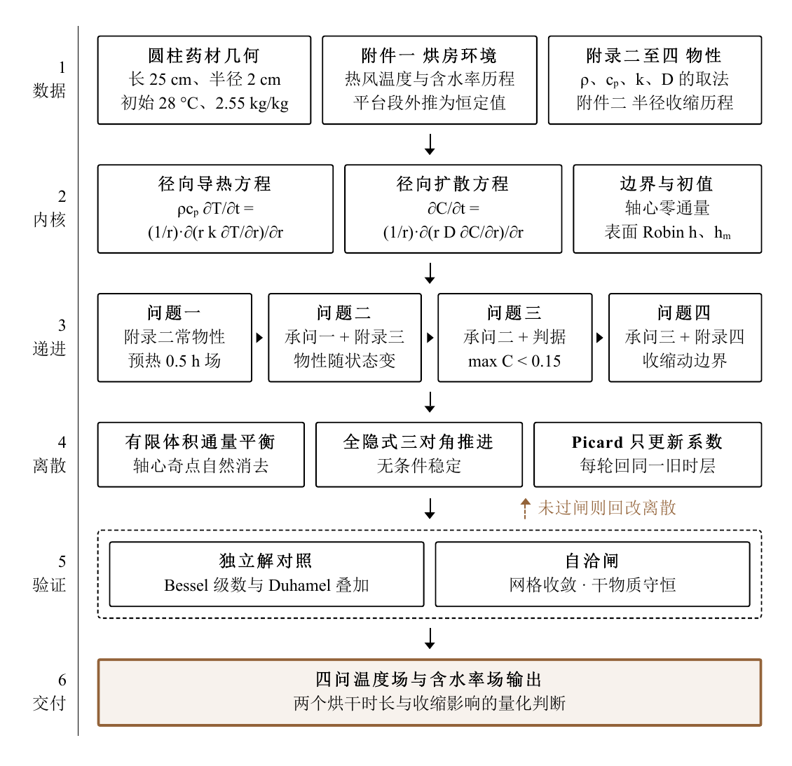

<div align="center">

# Herb Hot-Air Drying Model

**From temperature and moisture fields to drying-time prediction.**

Coupled heat and mass transfer · Finite volume method · ALE moving boundary · Python

[简体中文](README.md) · **English** · [Русский](README.ru.md)

[Read the paper](paper.pdf) · [Explore the problem](problems) · [Browse the code](codes) · [Get the results](results)

</div>

---

How does a cylindrical medicinal herb heat up and lose moisture in hot air? How long does drying take when shrinkage is included? This project tackles these questions through four progressively extended models, with a **paper PDF, the complete problem materials, Python solvers, and result spreadsheets for all four tasks** to support learning, reproduction, and further research.

> ⭐ If this project helps you with mathematical modeling, heat and mass transfer, or numerical computing, please give it a **[Star](https://github.com/xingalwang/herb-drying-model)**. It supports the project and makes it easier to find again.

## Highlights

- **Four connected tasks:** from preheating with constant properties to coupled transport with variable properties, drying-endpoint prediction, and a shrinking domain.
- **Readable computation:** parameters, material properties, and shared solver functions are organized separately, with one entry point to run the stages in order.
- **Complete materials:** original inputs, blank templates, and computed outputs are kept separately; all four result spreadsheets are ready to inspect.
- **Validation code included:** structural checks, convergence studies, and sensitivity analysis, plus ANSYS input files and selected results.

## Paper framework

The figure below comes from the paper and connects the inputs, governing equations, four modeling tasks, numerical discretization, and validation. The original figure remains in Chinese.

<p align="center">
  
</p>

## Key results

These are previously computed results supplied with the repository, taken from [`results/all_results.json`](results/all_results.json).

| Task | Model or quantity | Representative result |
| --- | --- | --- |
| 1 | Preheating with constant properties | Center temperature at 1800 s: **33.5756 °C** |
| 2 | Coupled transport with variable properties | Mean moisture content at 3 h: **1.3825 kg/kg** |
| 3 | Drying endpoint with fixed geometry | Drying time: **57.4745 h** |
| 4 | Shrinkage with an ALE formulation | Drying time: **51.0888 h** |

Tasks 3 and 4 use the **maximum dry-basis moisture content over the domain falling below 0.15 kg/kg** as the stopping criterion. Their property formulas also differ, so the entire time difference cannot be attributed to shrinkage alone.

## Quick start

Python 3.11 or newer is recommended. Run these commands from the repository root:

```bash
python -m pip install -r requirements.txt
python codes/main.py
```

The entry point runs structural checks, Tasks 1–4, and sensitivity analysis in sequence. Supplied JSON files are reused when they pass the program's checks, so the default run can quickly summarize existing results; **it does not recompute every experiment**.

To recompute all stages:

```bash
python codes/main.py --force
```

A full run includes convergence studies and parameter sweeps. Runtime depends on your hardware, and the corresponding Excel and JSON files under `results/` will be overwritten. Input attachments and blank templates are preserved.

Run Task 1 separately:

```bash
python codes/problem1.py
```

Some comparisons in Task 4 read Task 3 results, so running the main entry point in order is recommended. Optional extended analysis for Task 4:

```bash
python codes/main.py --analysis-global --quick
```

Extended analysis writes to `results/enhanced_q4/`; temporary files go to `_tmp/`.

## Repository layout

| Location | Contents |
| --- | --- |
| [`paper.pdf`](paper.pdf) | Full paper PDF, including appendices |
| [`problems/`](problems) | Problem PDF, text, original data, and four blank output templates |
| [`codes/`](codes) | Four solvers, parameters, properties, shared functions, checks, and sensitivity analysis |
| [`codes/ansys/`](codes/ansys) | 11 ANSYS APDL input files |
| [`results/`](results) | Four completed Excel files, per-stage JSON files, and a summary |
| [`results/ansys/`](results/ansys) | Selected simulation metrics and tables |
| [`requirements.txt`](requirements.txt) | Python dependencies |

`problems/附件/附件3/` contains the original blank templates; `results/result1.xlsx` through `result4.xlsx` contain computed outputs. The solver reads Attachments 1 and 2 directly, with no separate preprocessing step. Paper figures and tables can be viewed in the PDF.

## Model and reproduction notes

- The continuous main model uses one-dimensional radial transport, with plateau extrapolation of the long-term air conditions. Results depend on the prescribed properties and modeling assumptions described in the paper.
- The original ANSYS environment was recorded as **2026 R1**. Running the APDL files requires a separate installation with appropriate usage rights. Run each input in its own working directory to prevent output-name collisions.
- Task 4 ANSYS files advance a supplied state by **1 s** for local snapshot checks; they are not a continuous three-dimensional moving-boundary simulation of the entire process.
- The organized copy changes only input and output paths. Module imports, input loading, cached summaries, small solver cases, and Excel I/O have been checked. **The full experiment suite and ANSYS cases have not been rerun during repository preparation.**

Runtime-check environment: Python 3.12.3, NumPy 2.5.4, SciPy 1.18.1, pandas 3.1.0, and openpyxl 3.1.5.

## Discussion and support

Use [Issues](https://github.com/xingalwang/herb-drying-model/issues) to report reproduction problems, discuss assumptions, or share improvements. If you use this project for learning or research, please cite the paper title and link to this repository.

Found it useful? A **⭐ Star** in the top-right corner is always welcome. Thank you for your interest and support!

## License and sources

Original code under `codes/` is licensed under the [MIT License](LICENSE). This license does not extend to the problem statement, problem data, paper, or other third-party materials; their respective rights and permissions remain with their rights holders. Problem files are preserved as supplied, and their inclusion does not independently establish redistribution permission.
