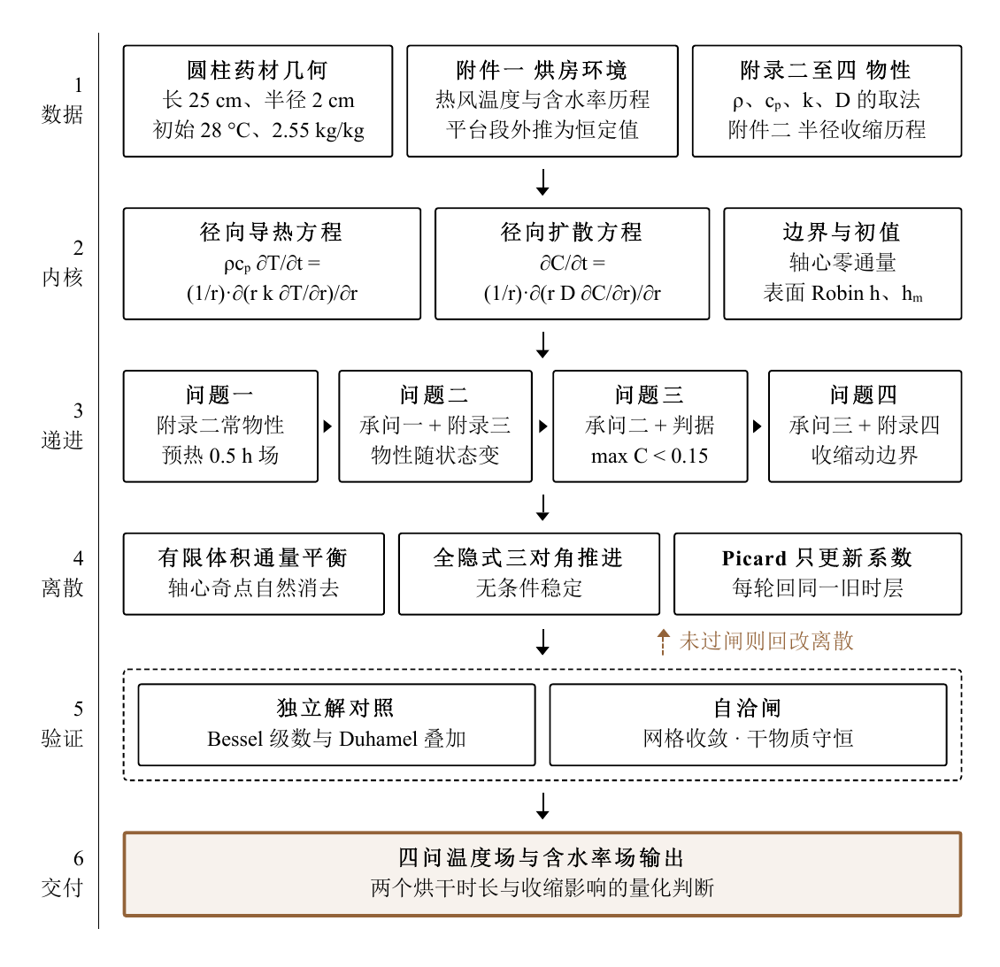

<div align="center">

# 2026 数模国赛 A 题｜药材热风烘干模型

**从温湿场演化，到烘干终点预测。**

热质耦合 · 有限体积法 · ALE 动边界 · Python

**简体中文** · [English](README.en.md) · [Русский](README.ru.md)

[阅读论文](paper.pdf) · [查看赛题](problems) · [浏览代码](codes) · [获取结果](results)

</div>

---

这是 <strong>2026 年高教社杯全国大学生数学建模竞赛（数模国赛）A 题“药材的烘干问题”</strong>的论文与代码仓库。竞赛信息见 [CUMCM 官网](https://en.mcm.edu.cn/)。

圆柱药材在热风中怎样升温、失水？考虑收缩后，又需要多久才能烘干？本项目用四个逐步扩展的模型回答这些问题，并提供**论文 PDF、完整赛题、Python 求解代码和四问结果表**，方便学习、复算和进一步研究。

> ★ 如果这个项目对你的数学建模、传热传质学习或数值计算有帮助，欢迎点一个 **[Star](https://github.com/xingalwang/cumcm-2026-a-herb-drying)**，支持这个项目，也方便以后再找到它。

## 项目亮点

- **四问贯通**：从常物性预热，扩展到变物性热质耦合、长时烘干终点和收缩动边界。
- **计算过程可读**：参数、物性公式与公共求解函数分开组织，主入口按顺序调度各阶段。
- **材料完整**：赛题输入、空白模板与已计算结果分别保留；四个 Excel 结果可以直接查看。
- **验证内容随代码提供**：包含结构性检验、收敛研究和灵敏度分析，并附 ANSYS 输入及选定结果。

## 论文框架

下图来自论文，展示数据、控制方程、四问递进、数值离散与验证之间的关系。

<p align="center">
  
</p>

## 主要结果

以下为仓库附带的历史计算结果，数值来源为 [`results/all_results.json`](results/all_results.json)。

| 问题 | 计算内容 | 代表性结果 |
| --- | --- | --- |
| 一 | 常物性预热阶段 | 1800 s 时中心温度 **33.5756 °C** |
| 二 | 变物性热质耦合 | 3 h 时平均含水率 **1.3825 kg/kg** |
| 三 | 固定几何的烘干终点 | 烘干时长 **57.4745 h** |
| 四 | 考虑收缩的 ALE 模型 | 烘干时长 **51.0888 h** |

问题三、四按**全场最大干基含水率低于 0.15 kg/kg**判定终点。两问的物性公式也有所不同，时长之差不能全部归因于几何收缩。

## 快速开始

建议使用 Python 3.11 或更新版本。在仓库根目录执行：

```bash
python -m pip install -r requirements.txt
python codes/main.py
```

主程序依次处理结构性检验、问题一至四和灵敏度分析。附带的 JSON 通过程序内检查时会被复用，因此默认运行可以快速查看已有结果；**这不等于重新完成全部计算**。

完整重算：

```bash
python codes/main.py --force
```

完整计算包含收敛研究和参数扫描，耗时随设备而异，并会覆盖 `results/` 下对应的 Excel 和 JSON。输入附件与空白模板不会被覆盖。

单独运行问题一：

```bash
python codes/problem1.py
```

问题四的部分对照读取问题三结果，建议先按主入口顺序运行。问题四扩展分析为可选项：

```bash
python codes/main.py --analysis-global --quick
```

扩展分析输出到 `results/enhanced_q4/`，临时文件写入 `_tmp/`。

## 仓库结构

| 位置 | 内容 |
| --- | --- |
| [`paper.pdf`](paper.pdf) | 完整论文 PDF，含附录 |
| [`problems/`](problems) | 赛题 PDF、文本、原始数据和四个空白结果模板 |
| [`codes/`](codes) | 四问求解、参数、物性、公共函数、检验与灵敏度分析 |
| [`codes/ansys/`](codes/ansys) | 11 个 ANSYS APDL 输入文件 |
| [`results/`](results) | 已填写的四个结果 Excel、各阶段 JSON 和汇总 |
| [`results/ansys/`](results/ansys) | 选定的仿真指标及结果表 |
| [`requirements.txt`](requirements.txt) | Python 依赖 |

`problems/附件/附件3/` 中是原始空白模板，`results/result1.xlsx` 至 `result4.xlsx` 是已计算结果。求解器直接读取附件1、附件2，无需额外的数据预处理。论文中的图表可直接在 PDF 中查看。

## 模型与复现说明

- 连续主模型采用一维径向输运；长时空气条件采用平台外推。结果依赖题设物性和相应建模假设，具体见论文。
- ANSYS 原环境记录为 **2026 R1**，运行 APDL 文件需另行安装具备相应使用权限的软件。各输入文件应在独立工作目录运行，避免同名输出覆盖。
- 问题四的 ANSYS 文件是从给定状态继续推进 **1 s** 的局部快照复核，不代表连续三维动边界全程求解。
- 整理版仅调整输入、输出路径。已完成模块导入、附件读取、缓存汇总、小规模求解和 Excel 读写检查，**未重新计算全部实验或重跑 ANSYS**。

运行检查环境：Python 3.12.3、NumPy 2.5.4、SciPy 1.18.1、pandas 3.1.0、openpyxl 3.1.5。

## 交流与支持

欢迎通过 [Issues](https://github.com/xingalwang/cumcm-2026-a-herb-drying/issues) 反馈复现问题、讨论模型假设，或分享你的改进。若使用本项目进行学习或研究，请注明论文标题及本仓库链接。

觉得有用的话，也欢迎点亮右上角的 **★ Star**。感谢你的关注与支持！

## 授权与来源

原创代码（`codes/`）采用 [MIT License](LICENSE)。MIT 许可不扩展至赛题、赛题数据、论文或其他第三方材料，这些内容的权利与授权分别归其权利人。赛题按现有原文件保留，其随仓库提供不构成对再分发权限的独立确认。
