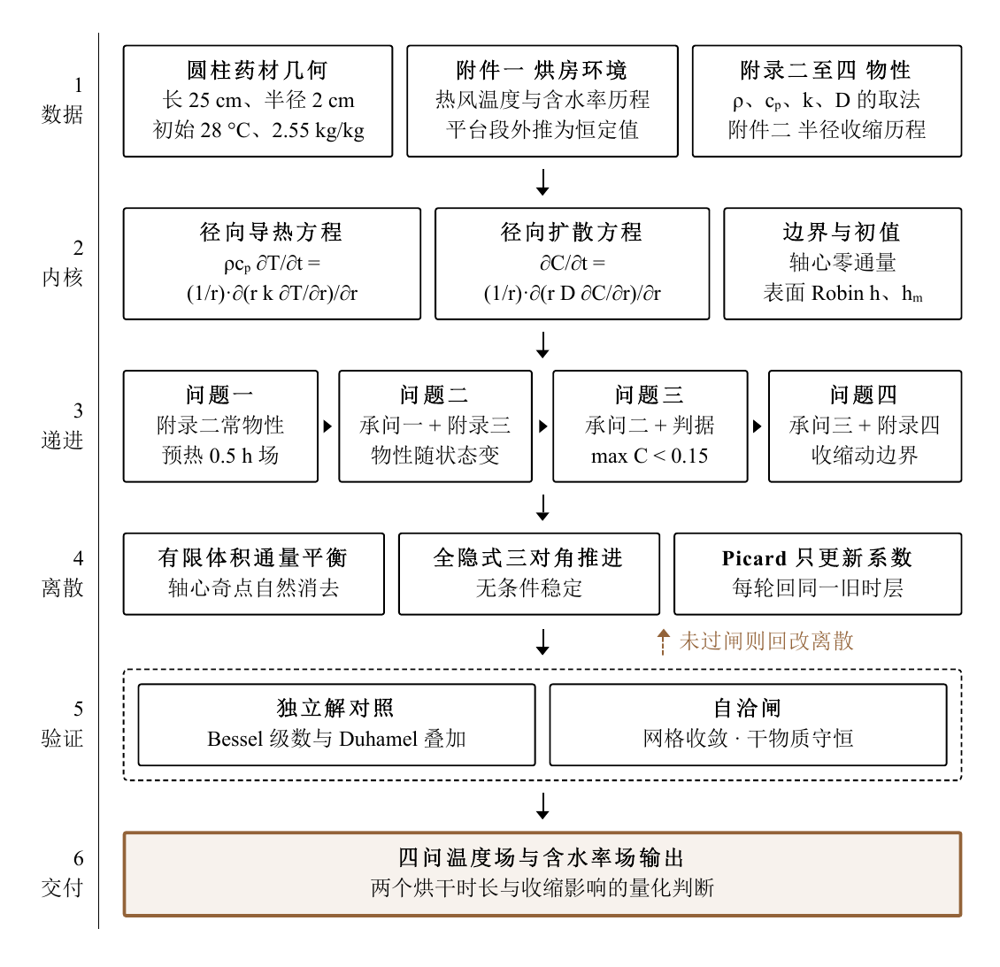

<div align="center">

# CUMCM 2026 · Задача A: сушка лекарственного сырья

**От полей температуры и влагосодержания к прогнозу времени сушки.**

Связанный тепло- и массоперенос · Метод конечных объёмов · Подвижная граница ALE · Python

[简体中文](README.md) · [English](README.en.md) · **Русский**

[Читать статью](paper.pdf) · [Условие задачи](problems) · [Исходный код](codes) · [Результаты](results)

</div>

---

Статья и код для **задачи A «Сушка лекарственного сырья» Всекитайского студенческого конкурса по математическому моделированию 2026 года (CUMCM)**. Информация о конкурсе: [официальный сайт CUMCM](https://en.mcm.edu.cn/).

Как цилиндрический образец лекарственного сырья нагревается и теряет влагу в горячем воздухе? Сколько времени занимает сушка с учётом усадки? Проект отвечает на эти вопросы с помощью четырёх последовательно расширяемых моделей. Здесь собраны **статья в PDF, полный комплект материалов задачи, решатели на Python и таблицы результатов для всех четырёх заданий** — для обучения, воспроизведения расчётов и дальнейших исследований.

> ★ Если проект помогает вам изучать математическое моделирование, тепло- и массоперенос или численные методы, поставьте **[Star](https://github.com/xingalwang/cumcm-2026-a-herb-drying)**. Так вы поддержите проект и сможете быстрее найти его в будущем.

## Что есть в проекте

- **Четыре связанные задачи:** от предварительного нагрева при постоянных свойствах до связанного переноса с переменными свойствами, определения окончания сушки и учёта усадки.
- **Понятная организация расчёта:** параметры, свойства материала и общие функции решателя разделены; единая точка входа последовательно запускает этапы.
- **Полный комплект материалов:** исходные данные, пустые шаблоны и рассчитанные результаты хранятся отдельно; доступны четыре готовые таблицы Excel.
- **Код для проверки модели:** структурные проверки, исследования сходимости и анализ чувствительности, а также входные файлы ANSYS и выбранные результаты.

## Схема исследования

На рисунке из статьи показаны исходные данные, основные уравнения, четыре этапа моделирования, численная дискретизация и проверки. Оригинальная схема сохранена на китайском языке.

<p align="center">
  
</p>

## Основные результаты

Ниже приведены результаты предыдущих расчётов, включённые в репозиторий. Источник — [`results/all_results.json`](results/all_results.json).

| Задача | Модель или величина | Характерный результат |
| --- | --- | --- |
| 1 | Предварительный нагрев при постоянных свойствах | Температура в центре через 1800 с: **33.5756 °C** |
| 2 | Связанный перенос с переменными свойствами | Среднее влагосодержание через 3 ч: **1.3825 кг/кг** |
| 3 | Окончание сушки при фиксированной геометрии | Время сушки: **57.4745 ч** |
| 4 | Учёт усадки в постановке ALE | Время сушки: **51.0888 ч** |

В задачах 3 и 4 сушка завершается, когда **максимальное по всей области влагосодержание на сухую массу становится ниже 0.15 кг/кг**. Формулы свойств материала в этих задачах тоже различаются, поэтому всю разницу во времени нельзя приписывать только усадке.

## Быстрый запуск

Рекомендуется Python 3.11 или новее. Выполните команды из корневого каталога репозитория:

```bash
python -m pip install -r requirements.txt
python codes/main.py
```

Главная программа последовательно обрабатывает структурные проверки, задачи 1–4 и анализ чувствительности. Если сохранённые JSON проходят встроенные проверки, программа использует их повторно. Поэтому обычный запуск позволяет быстро получить сводку имеющихся результатов, **но не пересчитывает все эксперименты заново**.

Полный пересчёт:

```bash
python codes/main.py --force
```

Полный запуск включает исследования сходимости и перебор параметров. Время работы зависит от оборудования; соответствующие файлы Excel и JSON в `results/` будут перезаписаны. Исходные приложения и пустые шаблоны сохраняются.

Отдельный запуск первой задачи:

```bash
python codes/problem1.py
```

Некоторые сравнения в задаче 4 используют результаты задачи 3, поэтому рекомендуется сначала выполнить этапы через главную программу. Дополнительный анализ для задачи 4 запускается отдельно:

```bash
python codes/main.py --analysis-global --quick
```

Дополнительные результаты сохраняются в `results/enhanced_q4/`, временные файлы — в `_tmp/`.

## Структура репозитория

| Расположение | Содержимое |
| --- | --- |
| [`paper.pdf`](paper.pdf) | Полная статья в PDF с приложениями |
| [`problems/`](problems) | Условие задачи в PDF и текстовом формате, исходные данные и четыре пустых шаблона |
| [`codes/`](codes) | Решатели четырёх задач, параметры, свойства, общие функции, проверки и анализ чувствительности |
| [`codes/ansys/`](codes/ansys) | 11 входных файлов ANSYS APDL |
| [`results/`](results) | Четыре заполненных файла Excel, JSON по этапам и сводные данные |
| [`results/ansys/`](results/ansys) | Выбранные показатели и таблицы моделирования |
| [`requirements.txt`](requirements.txt) | Зависимости Python |

В `problems/附件/附件3/` находятся исходные пустые шаблоны, а файлы от `results/result1.xlsx` до `result4.xlsx` содержат рассчитанные результаты. Решатель напрямую читает приложения 1 и 2; отдельная предварительная обработка данных не требуется. Рисунки и таблицы статьи доступны в PDF.

## Модель и воспроизведение расчётов

- Основная непрерывная модель описывает одномерный радиальный перенос; условия воздуха на длительном интервале экстраполируются постоянными значениями плато. Результаты зависят от заданных свойств и принятых допущений, изложенных в статье.
- Исходная среда ANSYS указана как **2026 R1**. Для запуска APDL требуется отдельная установка программы с соответствующими правами использования. Запускайте каждый входной файл в отдельном рабочем каталоге, чтобы избежать перезаписи одноимённых результатов.
- Файлы ANSYS для задачи 4 продолжают расчёт заданного состояния на **1 с** для локальной проверки снимков полей. Это не непрерывный трёхмерный расчёт всего процесса с подвижной границей.
- При подготовке репозитория изменены только пути ввода и вывода. Проверены импорт модулей, чтение данных, сводка сохранённых результатов, небольшие расчётные примеры и чтение/запись Excel. **Полный пересчёт экспериментов и повторный запуск ANSYS не выполнялись.**

Среда проверки запуска: Python 3.12.3, NumPy 2.5.4, SciPy 1.18.1, pandas 3.1.0 и openpyxl 3.1.5.

## Обсуждение и поддержка

В [Issues](https://github.com/xingalwang/cumcm-2026-a-herb-drying/issues) можно сообщить о проблемах воспроизведения, обсудить допущения или предложить улучшения. Если вы используете проект в обучении или исследованиях, укажите название статьи и ссылку на этот репозиторий.

Проект оказался полезным? Будем рады **★ Star** в правом верхнем углу страницы. Спасибо за интерес и поддержку!

## Лицензия и источники

Оригинальный код в `codes/` распространяется по [лицензии MIT](LICENSE). Она не распространяется на условие задачи, данные задачи, статью и другие материалы третьих лиц; права и разрешения на них принадлежат соответствующим правообладателям. Файлы задачи сохранены в полученном виде; само их размещение в репозитории не является отдельным подтверждением права на дальнейшее распространение.
